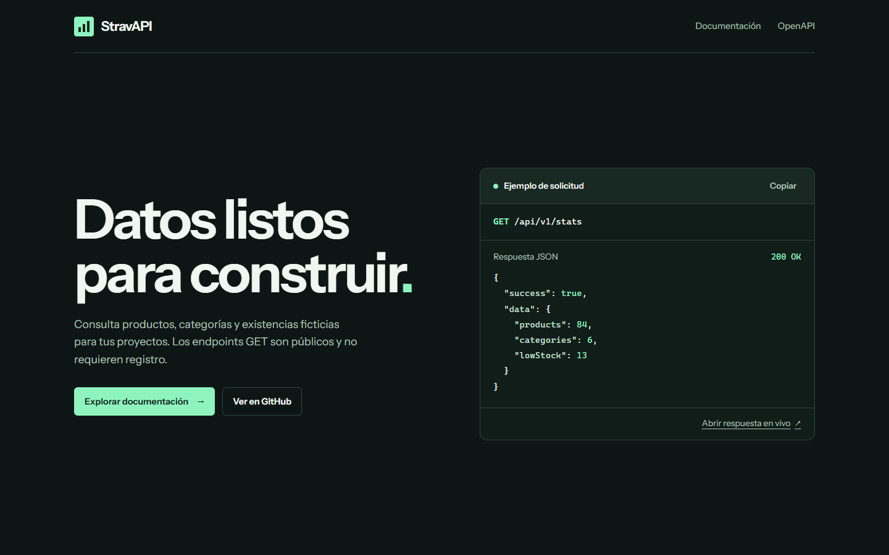
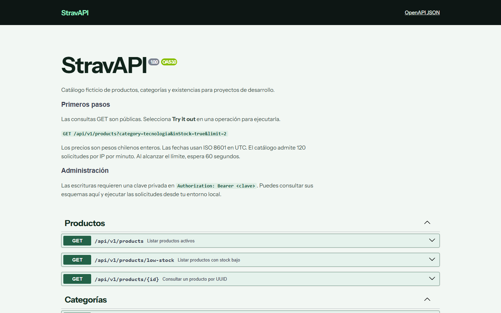
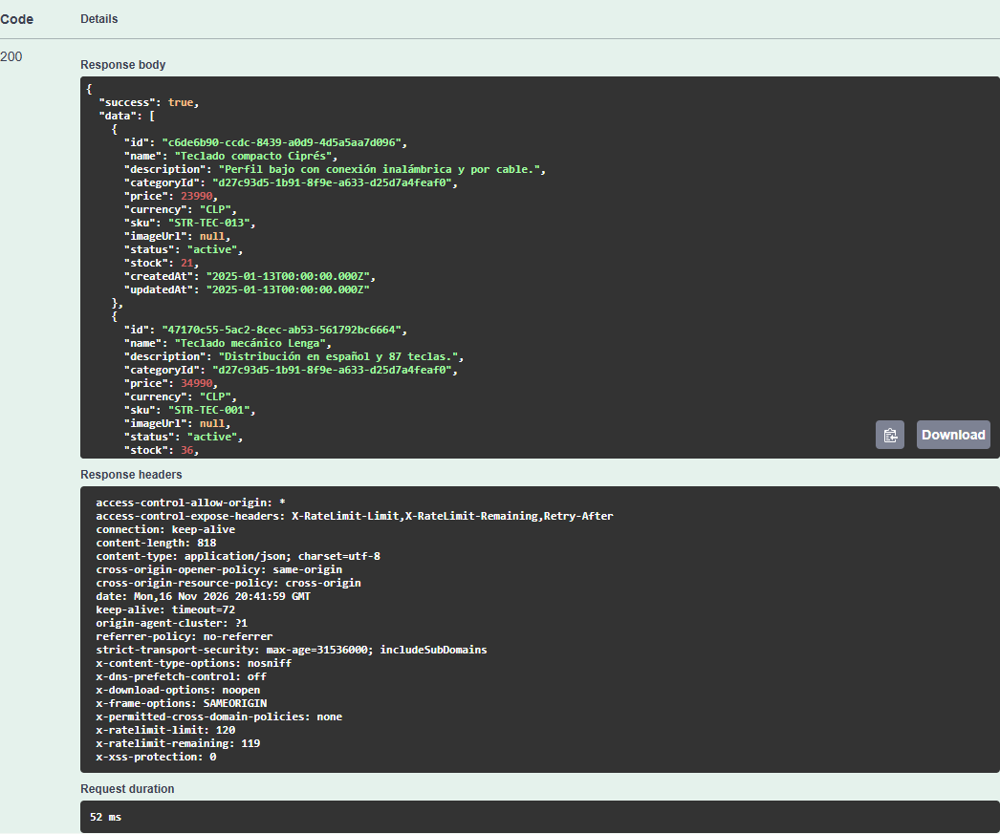

# StravAPI

**Datos listos para construir.** StravAPI es una API REST en español con un catálogo ficticio para tiendas de demostración, ejercicios de frontend, dashboards y aplicaciones de inventario. El seed incluye **84 productos en 6 categorías**, con precios y existencias realistas. Las consultas GET son públicas y las escrituras requieren una clave administrativa.

**Estado del servicio.** La aplicación y Swagger UI se pueden ejecutar localmente. Las URLs públicas de la API y de la referencia quedan pendientes de un despliegue verificado con una base Supabase dedicada.

## Portada y referencia interactiva

La portada está en `/`, la referencia Swagger UI en `/docs` y la especificación OpenAPI 3.0.3 en `/openapi.json`. Abre una operación GET, selecciona **Try it out** y luego **Execute** para ver la respuesta. Los esquemas de escritura también están disponibles en la referencia.





<details>
<summary>Ver una respuesta real ejecutada desde Swagger UI</summary>



</details>

## Inicio rápido

Requiere **Node.js 24 LTS** y npm. La demo usa PostgreSQL embebido mediante PGlite, migra y carga el catálogo en memoria al arrancar.

```sh
npm ci
npm run demo
```

Abre [la portada local](http://localhost:3000) o [la documentación local](http://localhost:3000/docs). Los cambios de la demo desaparecen al detener el proceso.

## Endpoints públicos

| Método | Ruta | Resultado |
| --- | --- | --- |
| GET | `/api/v1/products` | Productos activos con búsqueda, filtros, orden y paginación |
| GET | `/api/v1/products/:id` | Detalle de un producto activo por UUID |
| GET | `/api/v1/products/low-stock` | Productos activos con stock menor al umbral |
| GET | `/api/v1/categories` | Categorías ordenadas por nombre |
| GET | `/api/v1/categories/:slug` | Detalle de una categoría |
| GET | `/api/v1/categories/:slug/products` | Productos activos de una categoría |
| GET | `/api/v1/stats` | Conteo de productos activos, categorías y productos con stock menor a 10 |
| GET | `/health` | Salud del proceso |
| GET | `/ready` | Acceso a PostgreSQL y al almacenamiento del límite de tráfico |

| Parámetro de productos | Convención |
| --- | --- |
| `page`, `limit` | Página desde 1 (máximo 10.000). Tamaño predeterminado 20 y máximo 100 |
| `q` | Coincidencia parcial en el nombre, sin distinguir mayúsculas |
| `category` | Slug de la categoría. En la ruta anidada se toma del path |
| `minPrice`, `maxPrice` | Pesos chilenos enteros, extremos incluidos |
| `inStock` | `true` para stock positivo, `false` para stock cero |
| `sort`, `order` | `name`, `price` o `createdAt`. Orden `asc` o `desc`. Por defecto, `createdAt desc` |
| `threshold` | Solo en `/products/low-stock`. Entre 1 y 1000. Por defecto, 10 |

Los empates de ordenamiento se resuelven con el UUID. Todas las fechas se devuelven en ISO 8601 UTC. Los precios representan montos enteros en CLP.

```sh
curl "http://localhost:3000/api/v1/products?category=tecnologia&inStock=true&sort=price&order=asc&limit=2"
curl "http://localhost:3000/api/v1/stats"
```

En PowerShell, usa `curl.exe` si `curl` está reservado como alias.

```js
const url = new URL('/api/v1/products', 'http://localhost:3000');
url.search = new URLSearchParams({ q: 'teclado', limit: '5' });
const response = await fetch(url);
const payload = await response.json();
if (!response.ok) throw new Error(payload.error.message);
console.table(payload.data);
console.log(payload.pagination);
```

Respuesta de `GET /api/v1/stats` con el seed inicial:

```json
{
  "success": true,
  "data": {
    "products": 84,
    "categories": 6,
    "lowStock": 13
  }
}
```

Respuesta de error para un UUID válido ausente:

```json
{
  "success": false,
  "error": {
    "code": "PRODUCT_NOT_FOUND",
    "message": "El producto solicitado no existe."
  }
}
```

Las listas de productos también devuelven `pagination` con `page`, `limit`, `total` y `totalPages`. La baja administrativa exitosa devuelve `204` con cuerpo vacío.

## Administración

Todas las rutas siguientes están bajo `/api/v1/admin`. La clave va en `Authorization: Bearer <clave>`. Genera una clave local de 32 bytes con `node -e "console.log(require('node:crypto').randomBytes(32).toString('hex'))"` y configúrala en tu `.env` privado. En ausencia de clave de servidor, la administración permanece deshabilitada.

| Método | Ruta | Operación |
| --- | --- | --- |
| POST | `/products` | Crear un producto con stock cero |
| PATCH | `/products/:id` | Actualizar sus campos de catálogo |
| DELETE | `/products/:id` | Desactivar y conservar los movimientos |
| POST | `/categories` | Crear una categoría |
| PATCH | `/categories/:id` | Actualizar una categoría |
| POST | `/inventory/movements` | Registrar una entrada `in` o salida `out` |

Ejemplo para un entorno privado. Exporta `ADMIN_API_KEY` en tu shell local antes de usarlo:

```sh
curl -X POST "http://localhost:3000/api/v1/admin/categories" \
  -H "Authorization: Bearer $ADMIN_API_KEY" \
  -H "Content-Type: application/json" \
  -d '{"name":"Jardín","slug":"jardin","description":"Herramientas de jardinería ficticias."}'
```

Genera el cuerpo de un movimiento con `productId`, `type`, `quantity` y `reference`. Cada solicitud aceptada registra un movimiento. Si una respuesta se pierde tras el envío, comprueba el stock y el movimiento antes de repetirla.

| Código | Significado |
| --- | --- |
| 200 / 201 / 204 | Lectura o edición exitosa, creación o baja con cuerpo vacío |
| 400 | Parámetro, consulta o JSON inválido |
| 401 / 403 | Bearer ausente o mal formado, o clave sin acceso |
| 404 | Ruta o recurso inexistente |
| 409 | Duplicado, producto inactivo o existencias insuficientes |
| 413 / 415 | Cuerpo superior a 16 KiB o tipo de contenido incompatible |
| 422 | Referencia, rango de precios o límite de stock inválido |
| 429 | Límite de solicitudes alcanzado |
| 500 / 503 | Error interno o dependencia no disponible en `/ready` |

## PostgreSQL o Supabase

1. Crea una base dedicada para StravAPI. En Supabase, mantén `stravapi` fuera de los esquemas expuestos por la Data API.
2. Copia `.env.example` a `.env` y completa las variables. En Supabase, copia las conexiones desde **Connect**. Usa **Transaction pooler** para `DATABASE_URL` y **Session pooler** para `MIGRATION_DATABASE_URL`. El código requiere TLS con verificación de identidad para DB remotas.
3. Ejecuta `npm run db:migrate`, `npm run db:seed` y `npm run dev`.
4. Comprueba `/ready` y `/api/v1/stats` antes de usar el catálogo.

El seed usa UUID y SKU deterministas. Inserta categorías, productos y movimientos iniciales en una transacción. Una segunda ejecución conserva registros existentes y sus existencias.

| Variable | Uso |
| --- | --- |
| `DATABASE_URL` | Conexión privada de PostgreSQL para Fastify |
| `MIGRATION_DATABASE_URL` | Conexión privada con permisos DDL para migraciones y seed. Si falta, se usa `DATABASE_URL` |
| `ADMIN_API_KEY` | 64 caracteres hexadecimales aleatorios para las escrituras |
| `RATE_LIMIT_SECRET` | Secreto independiente de 64 caracteres hexadecimales. Obligatorio en Vercel |
| `ADMIN_CORS_ORIGINS` | Orígenes concretos separados por comas para administración desde otra web |
| `GITHUB_REPO_URL` | Sobrescribe el enlace a GitHub de la portada en copias del proyecto |
| `PORT`, `LOG_LEVEL` | Por defecto, `3000` e `info` |

Para un rol de ejecución independiente, crea un rol con login desde PostgreSQL y otorga únicamente estos permisos tras migrar. Sustituye `stravapi_runtime` por el rol creado:

```sql
GRANT USAGE ON SCHEMA stravapi TO stravapi_runtime;
GRANT SELECT, INSERT, UPDATE ON stravapi.categories, stravapi.products TO stravapi_runtime;
GRANT SELECT, INSERT ON stravapi.inventory_movements TO stravapi_runtime;
GRANT SELECT, INSERT, UPDATE, DELETE ON stravapi.rate_limits TO stravapi_runtime;
```

## Arquitectura y seguridad

- **Fastify y TypeScript estricto.** `src/index.ts` inicia el proceso. `src/application.ts` registra plugins, seguridad y rutas. `src/routes` traduce HTTP a operaciones de catálogo.
- **Drizzle y PostgreSQL.** `src/catalog.ts` contiene consultas parametrizadas y transacciones. `src/db` define el esquema y el pool. `drizzle/` versiona las migraciones SQL.
- **JSON Schema, Ajv y OpenAPI.** Los esquemas de entrada y de respuesta alimentan Swagger. Los cuerpos de escritura validan tipos y campos adicionales. Los logs estructurados usan la plantilla de ruta, el código HTTP y la duración.
- **Integridad.** PostgreSQL aplica claves foráneas, unicidad y límites. Los movimientos bloquean la fila de producto y actualizan stock e historial en una única transacción.
- **Límites.** El catálogo aplica 120 solicitudes válidas por IP y minuto. Las escrituras autenticadas tienen 60 por IP y minuto. Las ventanas y los contadores se comparten en PostgreSQL, con limpieza en lotes. El contador almacena un HMAC de la IP. En Vercel se usa el encabezado de IP que establece la plataforma. Documentación y comprobaciones de servicio quedan fuera de estos contadores.
- **Navegador.** Las lecturas de catálogo permiten CORS público sin credenciales. Las escrituras necesitan Bearer y CORS administrativo se habilita solo para orígenes explícitos.

## Pruebas y desarrollo

```sh
npm run typecheck
npm run lint
npm test
npm run build
npm start
```

La suite usa PostgreSQL embebido por defecto. GitHub Actions también ejecuta la suite con una base PostgreSQL 17 desechable. Para reproducirla localmente, usa una base vacía en loopback llamada `stravapi_test` y define `TEST_DATABASE_URL` solo para ese comando. El test rechaza URLs remotas y esquemas de prueba ya existentes.

Para regenerar las capturas, instala Chromium con `npx playwright install chromium` y ejecuta `npm run capture`. También puedes definir `BROWSER_CHANNEL=msedge` para usar Microsoft Edge instalado. El script comprueba teclado, layout responsive y una solicitud real desde Swagger UI.

## Despliegue

Importa este repositorio en Vercel con el preset Fastify y Node.js 24. Configura `DATABASE_URL` y `RATE_LIMIT_SECRET` como secretos. Configura `ADMIN_API_KEY` para habilitar la administración. Mantén las credenciales de migración fuera del runtime y configura una base aislada si habilitas previews con acceso a PostgreSQL.

Ejecuta las migraciones y el seed contra la nueva base. Valida la preview con `/health`, `/ready`, `/api/v1/stats`, `/docs` y `/openapi.json`. Comprueba que las escrituras anónimas se rechacen. Verifica de nuevo estos puntos en el dominio público después de promover el despliegue.

[Fastify en Vercel](https://vercel.com/docs/frameworks/backend/fastify) · [Conexiones PostgreSQL en Supabase](https://supabase.com/docs/guides/database/connecting-to-postgres)

## Posibles mejoras

- Idempotencia de movimientos mediante una referencia única aportada por el cliente.
- ETag y caché HTTP para lecturas de alto volumen.
- Búsqueda con índice trigram si aumenta el tamaño del catálogo.
